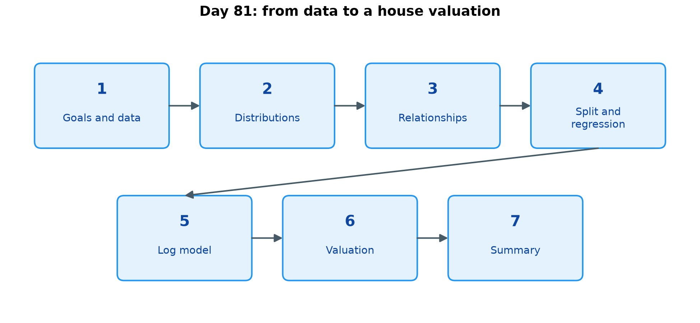
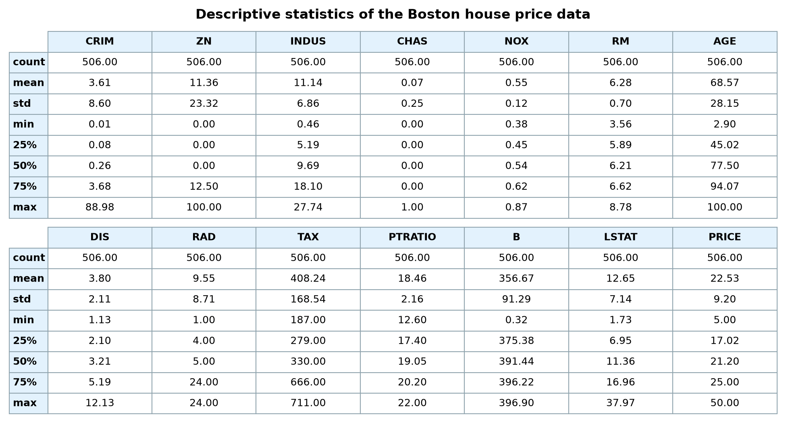
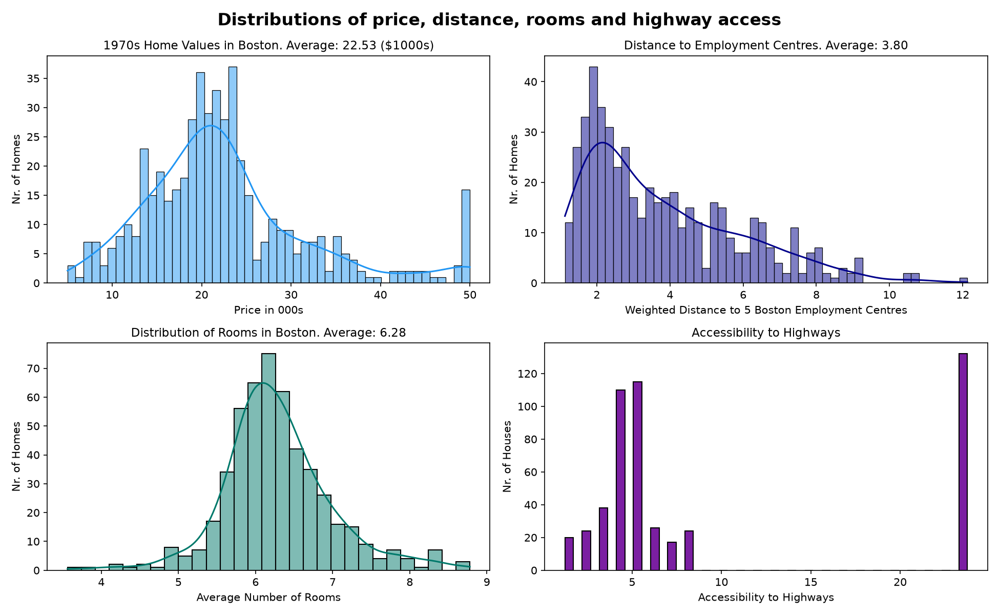

# 🚀 081 Multivariable Regression and Valuation Model

Day 81 of Udemy's *100 Days of Code: The Complete Python Pro Bootcamp*, as a tested, documented Python 3.13+ project: you are an analyst at a real estate development company in Boston in the 1970s and build a multivariable regression model that values a house from its characteristics. It is for fellow course participants who want to compare solutions, and for visitors looking for ideas.



## 📚 Table of Contents

- [Overview](#-overview)
- [Requirements](#-requirements)
- [Setup](#-setup)
- [Run](#-run)
- [Tests](#-tests)
- [License](#-license)
- [Links](#-links)
- [Appendix: Project documents](#-appendix-project-documents)

## 🧭 Overview

The assignment has two lectures. Lecture 597, "Day 81 Goals", sets the scene and the task: a real estate company wants a price estimate for a residential project before it starts, based on the number of rooms, the distance to employment centres, how rich or poor the area is, the number of students per teacher and similar characteristics. You analyse the Boston house price data, split it into training and test data, run a multivariable regression, evaluate the coefficients and the residuals, improve the model with a data transformation and finally value a property. Lecture 598, "Solution & Learning Points", gives the completed notebook and seven learning points: spotting relationships with a pair plot, splitting the data to judge a model on unseen data, running a multivariable regression, checking the sign of the coefficients, analysing the residuals, improving a model with a log transformation, and using the model to predict a price for chosen features.

The project turns the notebook into seven steps. Each step has code in `src/boston_valuation`, tests in `tests/`, a section in the notebook in `notebooks/`, a picture generated from the code, and a wiki page in English, Danish and Bahasa Malaysia that explains what the step teaches. The steps are added one by one, each with its own milestone and pull request.

| Folder | What it holds |
| --- | --- |
| `src/boston_valuation/` | The package: `constants.py`, `domain/` (the analysis rules), `infrastructure/` (reading the data), `presentation/` (charts and pictures), `data/` (the CSV file from the course) |
| `tests/` | pytest tests that check every figure the lectures rely on |
| `notebooks/` | The course's own start and complete notebooks (Jupyter) and this project's notebook |
| `docs/` | Project documents, the wiki sources in `docs/wiki/` and the pictures in `docs/images/` |
| `framework/` | The SQA and QC framework (a git submodule) that the project documents follow |
| `.editorconfig` | The editor settings of the framework baseline |
| `.env.example` | Placeholders for the git host tokens that the framework scripts read; the program itself reads no `.env` file |

### Steps

| Step | Wiki page | Picture |
| --- | --- | --- |
| Getting started | [Getting started][wiki-getting-started] | The commands for Windows and Linux |
| Step 1: Goals and data exploration | [Step 1: Goals and data exploration](https://git.tirsystem.com/Tirsvad-Udemy-100-days-of-code/081-multivariable-regression-and-valuation-model/wiki/Step-1-Goals-And-Data) |  |
| Step 2: Feature distributions | [Step 2: Feature distributions](https://git.tirsystem.com/Tirsvad-Udemy-100-days-of-code/081-multivariable-regression-and-valuation-model/wiki/Step-2-Distributions) |  |

The data and the notebooks come from the course resources and are used here for personal study; the rights stay with the course author. The data column `B` encodes a racial proportion of the town. It stays because the assignment uses it, and a model that uses it should not be put to real use.

## 📋 Requirements

- Python 3.13 or newer, to run the code.
- Git, to clone the repository.
- Runtime dependencies: `pandas`, `numpy`, `matplotlib`, `seaborn`, `plotly` and `scikit-learn`, installed by `pip`. Nothing else is needed to run the analysis.
- Optional: `pytest` and `ruff` (the `dev` extra); `jupyterlab` and `ipykernel` (the `notebook` extra, for the notebooks); Doxygen, to build the API pages; opengrep, to check the code before a push.

## 🛠️ Setup

Create and use a local `.venv`, upgrade `pip`, then install the project in editable mode.

Windows (PowerShell):

```powershell
git clone https://git.tirsystem.com/Tirsvad-Udemy-100-days-of-code/081-multivariable-regression-and-valuation-model.git
cd 081-multivariable-regression-and-valuation-model
python -m venv .venv
.venv\Scripts\Activate.ps1
python -m pip install --upgrade pip
python -m pip install -e ".[dev]"
```

Linux and macOS:

```bash
git clone https://git.tirsystem.com/Tirsvad-Udemy-100-days-of-code/081-multivariable-regression-and-valuation-model.git
cd 081-multivariable-regression-and-valuation-model
python3 -m venv .venv
source .venv/bin/activate
python -m pip install --upgrade pip
python -m pip install -e ".[dev]"
```

The wiki page [Getting Started][wiki-getting-started] has the same steps with notes for each system.

## ▶️ Run

With the `.venv` active, draw the pictures of the steps, or open the notebook:

```bash
python -m boston_valuation.presentation.screenshots
python -m pip install -e ".[notebook]"
jupyter lab notebooks
```

Build the API pages with `doxygen Doxyfile` (output in `docs/doxygen/html`).

## 🧪 Tests

```bash
python -m pytest
python -m ruff check src tests
```

Before every push, check the code with opengrep:

```bash
~/.opengrep/cli/latest/opengrep scan --config p/python src tests
```

## 📄 License

GNU Affero General Public License v3.0 only (AGPL-3.0-only); see [LICENSE][license].

## 🔗 Links

- [Repository][repository]
- [Documentation][documentation]
- [Issue tracker][issues]

## 📎 Appendix: Project documents

The documents a newcomer needs, in reading order.

| Document | What it tells you |
| --- | --- |
| [Business Case][BC-001] | Why the project exists, its scope and success criteria |
| [Stakeholder Analysis][SA-001] | Who is involved; the stakeholder IDs used for owners and reviewers |
| [Project Plan][PP-001] | The gateways and their schedule |
| [Milestones][milestones] | One document per gateway: Go/No-Go criteria and tasks |
| [Artifact registry][registry] | Where each artifact type lives, the next version, the PO language and domain |
| [Traceability matrix][TM-001] | How the artifacts link and when each was last reviewed |

---

[license]: ./LICENSE
[repository]: https://git.tirsystem.com/Tirsvad-Udemy-100-days-of-code/081-multivariable-regression-and-valuation-model
[documentation]: https://git.tirsystem.com/Tirsvad-Udemy-100-days-of-code/081-multivariable-regression-and-valuation-model/wiki
[issues]: https://git.tirsystem.com/Tirsvad-Udemy-100-days-of-code/081-multivariable-regression-and-valuation-model/issues
[wiki-getting-started]: https://git.tirsystem.com/Tirsvad-Udemy-100-days-of-code/081-multivariable-regression-and-valuation-model/wiki/Getting-Started
[BC-001]: ./docs/business-case.md
[SA-001]: ./docs/stakeholder-analysis.md
[PP-001]: ./docs/project-plan.md
[milestones]: ./docs/milestones/
[registry]: ./docs/artifact-registry.md
[TM-001]: ./docs/sqa/traceability-matrix.md
