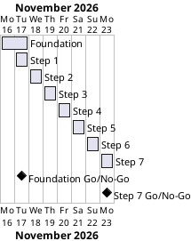

# Project Plan

## Metadata
| Key | Value |
| --- | --- |
| ID | PP-001 |
| CrossReference | [BC-001], [SA-001], [MIL-001], [MIL-002], [MIL-003], [MIL-004], [MIL-005], [MIL-006], [MIL-007], [MIL-008], [ADR-0001] |
| Language | en |
| Domain | it |

## Version History
| Date | Status | Author | Reviewer | Change | Commit |
| --- | --- | --- | --- | --- | --- |
| 2026-11-16 | Deprecated | Jens Tirsvad Nielsen | S01 | Initial version<br>Reviewed in RC-012: Go | [0e1081d] |
| 2026-11-16 | Accepted | Jens Tirsvad Nielsen | S01 (AI as stand-in) | Milestone column links the synced milestones<br>Reviewed in RC-023: Go | [c6ed0a7] |

---

## Purpose

This plan schedules the eight gateways that take the Day 81 course assignment (lectures 597 and 598) from an empty repository to a tested, documented and published project. The Business Case sets a deadline of one week after the plan is accepted, so the plan uses a one-week personal schedule.

## Planning Assumptions

- The plan starts 2026-11-16 and ends by 2026-11-23, one week (source: [BC-001], Constraints).
- One gateway for the foundation, one gateway per workflow step of the notebook, and one for the summary and release; one branch and one pull request per gateway (source: the user's prompt, and [BC-001], Objective 6).
- The reviewer is S01; in autonomous mode the AI acts as stand-in and records it in each `RC-*` (source: the user's prompt, `AGENTS.md`, Modes).
- The PO language is English and the PO domain is IT (source: the user's prompt).
- The two lectures are articles, not videos (source: reading the lectures on 2026-11-16); the steps are the sections of the notebook that lecture 597 introduces and lecture 598 summarises.
- A gateway with a No-Go verdict is fixed and reviewed again by S01 before the next gateway starts; later gateways move by the days lost, and only S01 decides to move the end date 2026-11-23, which is the deadline of the Business Case.
- Pictures for the README and the wiki are rendered from the project's own output; no lecture screenshot is used (source: the user's prompt).

## Gateway Schedule

| Gateway | Document | Window | Decision date | Owner | Stories | Main deliverable | Milestone |
| --- | --- | --- | --- | --- | --- | --- | --- |
| Foundation | [MIL-001] | 2026-11-16 to 2026-11-17 | 2026-11-17 | S01 | none (technical tasks, [ADR-0001]) | Skeleton, tooling, data, README, Getting Started wiki, repository metadata | [MIL-001 on the host](https://git.tirsystem.com/Tirsvad-Udemy-100-days-of-code/081-multivariable-regression-and-valuation-model/milestone/602) |
| Step 1: goals and data exploration (lecture 597) | [MIL-002] | 2026-11-17 | 2026-11-17 | S01 | none (technical tasks, [ADR-0001]) | Loader, exploration, descriptive statistics | [MIL-002 on the host](https://git.tirsystem.com/Tirsvad-Udemy-100-days-of-code/081-multivariable-regression-and-valuation-model/milestone/603) |
| Step 2: feature distributions | [MIL-003] | 2026-11-18 | 2026-11-18 | S01 | none (technical tasks, [ADR-0001]) | Price, distance, rooms, highway and river charts | [MIL-003 on the host](https://git.tirsystem.com/Tirsvad-Udemy-100-days-of-code/081-multivariable-regression-and-valuation-model/milestone/604) |
| Step 3: relationships | [MIL-004] | 2026-11-19 | 2026-11-19 | S01 | none (technical tasks, [ADR-0001]) | Pair plot and five joint plots | [MIL-004 on the host](https://git.tirsystem.com/Tirsvad-Udemy-100-days-of-code/081-multivariable-regression-and-valuation-model/milestone/605) |
| Step 4: split and regression | [MIL-005] | 2026-11-20 | 2026-11-20 | S01 | none (technical tasks, [ADR-0001]) | 80/20 split, regression, coefficients, residuals | [MIL-005 on the host](https://git.tirsystem.com/Tirsvad-Udemy-100-days-of-code/081-multivariable-regression-and-valuation-model/milestone/606) |
| Step 5: log transformation | [MIL-006] | 2026-11-21 | 2026-11-21 | S01 | none (technical tasks, [ADR-0001]) | Log model, comparison, out-of-sample r-squared | [MIL-006 on the host](https://git.tirsystem.com/Tirsvad-Udemy-100-days-of-code/081-multivariable-regression-and-valuation-model/milestone/607) |
| Step 6: valuation | [MIL-007] | 2026-11-22 | 2026-11-22 | S01 | none (technical tasks, [ADR-0001]) | Estimated value of the average and the described property | [MIL-007 on the host](https://git.tirsystem.com/Tirsvad-Udemy-100-days-of-code/081-multivariable-regression-and-valuation-model/milestone/608) |
| Step 7: summary and release (lecture 598) | [MIL-008] | 2026-11-23 | 2026-11-23 | S01 | none (technical tasks, [ADR-0001]) | Learning points, published wiki, release v1.0.0 | [MIL-008 on the host](https://git.tirsystem.com/Tirsvad-Udemy-100-days-of-code/081-multivariable-regression-and-valuation-model/milestone/609) |



## Scope Coverage

| Business Case scope item | Gateway |
| --- | --- |
| Python 3.13+, venv, pyproject, .gitignore, constants.py, Doxygen, Doxyfile | [MIL-001] |
| Data file and notebooks | [MIL-001] |
| Code and tests for the workflow | [MIL-002] to [MIL-007] |
| README, wiki in en, da and ms, a picture per step | [MIL-001] to [MIL-008] |
| Getting Started with Linux and Windows guides | [MIL-001] |
| opengrep before each push | every gateway |
| Repository description and topics | [MIL-001] |

## Dependencies

```
MIL-001 → MIL-002 → MIL-003 → MIL-004 → MIL-005 → MIL-006 → MIL-007 → MIL-008
```

## Plan Risks

| Risk | Impact | Mitigation |
| --- | --- | --- |
| Figures differ with the installed scikit-learn or pandas (Business Case risk: regression figures differ) | Tests fail | Assert with tolerances; the figures come from the course's complete notebook |
| The pair plot of 14 columns is slow | Slow tests | Test it on a subset of columns |
| Three wiki languages for eight pages | Plan overrun | One page per step; English first, then da and ms in the same pull request |
| Udemy bot check blocks a lecture or resource (Business Case risk) | Missing source | Both lectures and both resources are already read and downloaded; no further access is needed |

## Open Issues

- Whether the repository is public decides whether `docs/ai-prompts/` is ignored; it is ignored in `.gitignore` from the start, because the log may hold personal data.
- The wiki is written in `docs/wiki/` and published to the host wiki in [MIL-008]; the host wiki repository is created by the first push.

---

[BC-001]: ./business-case.md
[ADR-0001]: ./adr/adr-0001-skip-use-case-artifacts.md
[SA-001]: ./stakeholder-analysis.md
[MIL-001]: ./milestones/mil-001-foundation.md
[MIL-002]: ./milestones/mil-002-step-1-goals-and-data-exploration.md
[MIL-003]: ./milestones/mil-003-step-2-feature-distributions.md
[MIL-004]: ./milestones/mil-004-step-3-relationships.md
[MIL-005]: ./milestones/mil-005-step-4-split-and-regression.md
[MIL-006]: ./milestones/mil-006-step-5-log-transformation.md
[MIL-007]: ./milestones/mil-007-step-6-valuation.md
[MIL-008]: ./milestones/mil-008-lecture-598-summary-release.md
[0e1081d]: https://git.tirsystem.com/Tirsvad-Udemy-100-days-of-code/081-multivariable-regression-and-valuation-model/commit/0e1081ddb340d222e4fb986725d5a7feef19e5f8
[c6ed0a7]: https://git.tirsystem.com/Tirsvad-Udemy-100-days-of-code/081-multivariable-regression-and-valuation-model/commit/c6ed0a768a7fef6d86d64d622dbb1bc94e6ce4f4
